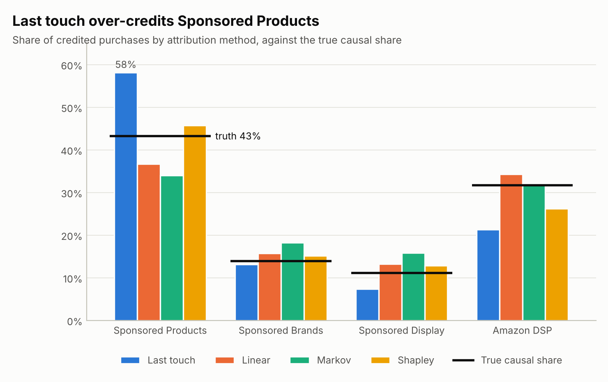
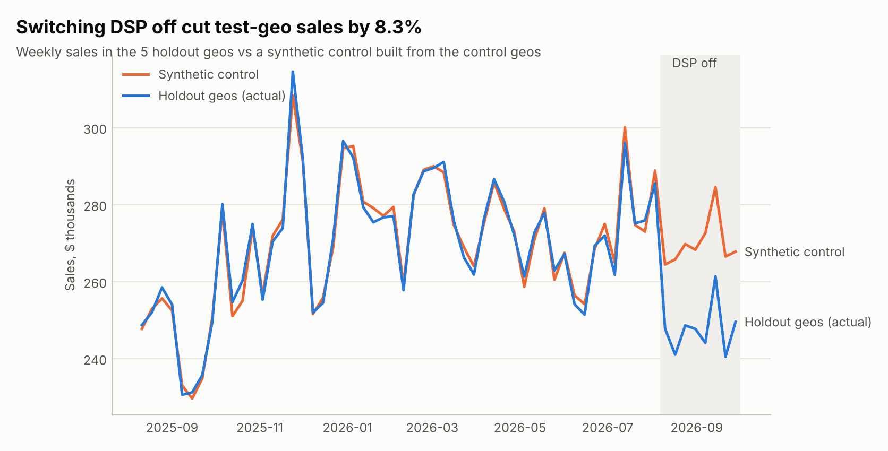
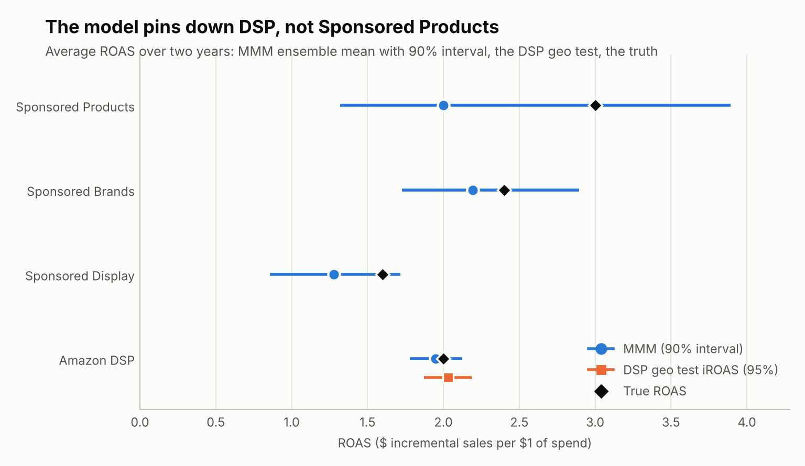
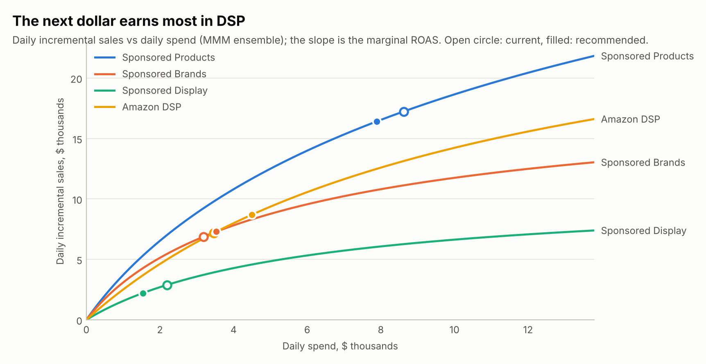
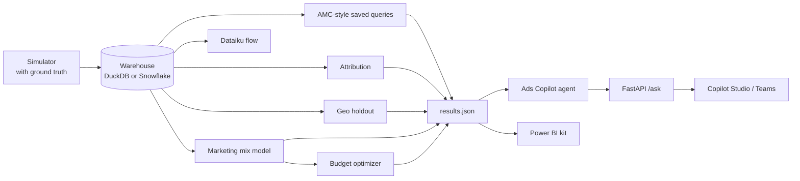

# retail-media-lab

**Amazon Ads analytics the way a brand's data science team does it: AMC-style SQL, multi-touch
attribution, a geo holdout test, a marketing mix model and a budget optimizer. Every method is
scored against a simulator that knows the true answer.** The SQL is written once in Snowflake's
dialect. An LLM analytics agent sits on top, served over FastAPI with a Copilot Studio connector,
and the repo ships Power BI and Dataiku kits.

[](https://github.com/faizanreza-cs/retail-media-lab/actions/workflows/ci.yml)


Amazon's attribution reports credit an ad with every purchase it touched. A brand's real
questions are different: what did the ads **cause**, and where should the next dollar go? Real
Amazon Marketing Cloud (AMC) data can't be shared, so this repo simulates two years of
advertising for a fictional supplements brand, **Fernway Nutrition**. The simulator knows the
true effect of every channel, which shows exactly how far each standard method gets.

## What it found

| Question | Method | Answer | Truth |
|---|---|---|---|
| How much do ads drive? | Any click-based attribution | 5,809 purchases credited to ads | **3,234** caused by ads (attribution over-credits **1.8x**) |
| Which channel drives purchases? | Last touch / Shapley | Sponsored Products 58% / 46% | **43%** |
| What did DSP add? | Geo holdout, difference-in-differences | iROAS **2.03** (95% CI 1.87-2.19) | 1.90 |
| | Geo holdout, synthetic control | iROAS **1.95** (95% CI 1.70-2.20) | 1.90 |
| ROAS by channel | Marketing mix model | DSP **1.95** (90% interval 1.78-2.12) | 2.00 |
| | | Sponsored Products 2.00 (**1.32-3.89**, can't pin it down) | 3.00 |
| Where should budget go? | Optimizer on the MMM curves (each channel moves at most 30%) | Move money from Display and Products into DSP and Brands | **+1.0%** ad-driven sales at the same budget (about $168k a year), 89% of the best possible plan |

### 1. Attribution: click-based methods can't see causation



| Share of credited purchases | Last touch | First touch | Linear | Markov | Shapley | **Truth** |
|---|---|---|---|---|---|---|
| Sponsored Products | 58.2% | 19.8% | 36.7% | 34.0% | 45.7% | **43.3%** |
| Sponsored Brands | 13.2% | 12.0% | 15.8% | 18.2% | 15.1% | **13.9%** |
| Sponsored Display | 7.4% | 15.5% | 13.3% | 15.8% | 12.9% | **11.1%** |
| Amazon DSP | 21.3% | 52.7% | 34.3% | 32.0% | 26.3% | **31.7%** |
| Total share error vs truth | 14.9 pts | 25.4 pts | 6.6 pts | 9.3 pts | **5.4 pts** | |

Sponsored Products ads are shown to shoppers who are already searching the category and often
buy anyway, so last touch rewards them for purchases they didn't cause. The data-driven methods
(Shapley, Markov) and even linear rules fix most of the split. But every one of them still
credits ads with all 5,809 purchases by exposed shoppers, while ads actually caused 3,234.
Only an experiment can measure that.

### 2. The geo holdout measures what DSP adds



DSP was switched off in 5 of 20 geos for the last 8 weeks. Both methods recover the true sales
loss ($175k) inside their confidence intervals:

| Method | Sales change in test geos | Sales lost | iROAS |
|---|---|---|---|
| Difference-in-differences (geo and week fixed effects, clustered SE) | -8.6% | $186.8k (95% CI $172.3k-$201.3k) | 2.03 (1.87-2.19) |
| Synthetic control (placebo-test interval) | -8.3% | $179.2k ($156.3k-$202.1k) | 1.95 (1.70-2.20) |
| **Truth** | | **$175.1k** | **1.90** |

The spend the test saved is estimated from control-geo spend at $92.0k (true $92.3k).

With only 20 geos, are the intervals honest? In placebo tests that pretend 5 control geos were
switched off, the 95% intervals wrongly excluded zero 5.3% of the time for
difference-in-differences (t-based clustered errors, 300 tests) and 7% for synthetic control
(100 tests). Normal-based clustered errors would have given 8.3%.

### 3. The marketing mix model, and where it can't decide



The model explains daily sales with trend, seasonality, retail events and coupons, plus adstock
(carry-over) and saturation per channel. It fits 728 days with R² 0.85 and 2.6% cross-validated
error. Many decay and saturation settings fit almost equally well, so the model keeps the 20
best (an ensemble). Its intervals combine that model uncertainty with resampled noise:

| Channel | ROAS (90% interval) | True | Marginal ROAS at current spend | True |
|---|---|---|---|---|
| Sponsored Products | 2.00 (1.32-3.89) | 3.00 | 1.09 (0.87-1.26) | 0.84 |
| Sponsored Brands | 2.19 (1.73-2.90) | 2.40 | 1.26 (0.67-1.79) | 1.12 |
| Sponsored Display | 1.28 (0.86-1.72) | 1.60 | 0.94 (0.61-1.30) | 0.93 |
| Amazon DSP | **1.95 (1.78-2.12)** | 2.00 | **1.57 (1.41-1.71)** | 1.51 |

Point estimates are the ensemble mean, so ROAS times spend equals the incremental sales the
model reports. DSP is pinned down: the MMM (1.95), the geo test (1.95-2.03) and the truth (2.00)
agree.
Sponsored Products is always on and close to saturation, so its spend barely varies and the
data can't separate it from baseline demand. The wide interval says so honestly. The fix is an
experiment: an SP budget-split test, like the DSP holdout.

### 4. Budget plan



At the current $17.5k a day and a ±30% limit per channel, the optimizer moves money until the
next dollar earns the same everywhere it can: Products and Brands end at a marginal ROAS of
1.16, while Display and DSP stop at their limits.

| Channel | Current daily spend | Recommended | Change |
|---|---|---|---|
| Sponsored Products | $8,622 | $7,890 | -8.5% |
| Sponsored Brands | $3,181 | $3,533 | +11.1% |
| Sponsored Display | $2,195 | $1,536 | -30.0% |
| Amazon DSP | $3,461 | $4,500 | +30.0% |

Scored with the simulator's true curves, the plan raises ad-driven sales by **1.0%**
($44,403 to $44,863 a day, about $168k a year) at the same budget. That's 89% of the best plan
possible under the same limits (+1.2%). With tighter limits the model's plan comes closer to
the best one: 94% of it at ±20%, 95% at ±10%. The model is most reliable near current spend.

## What's inside

| Part | What it does | Tech |
|---|---|---|
| Simulator (`rml/synth.py`) | AMC-shaped shopper journeys (60 days, 120k shoppers) and two years of geo x day spend and sales, with the true effect of every channel | Python, NumPy |
| AMC-style SQL (`rml/sql/`) | Path to conversion, new-to-brand, DSP frequency, ad type overlap, time to conversion, campaign reach; rows with fewer than 100 users are dropped, as in AMC | **Snowflake SQL**, run locally on DuckDB via sqlglot |
| Attribution (`rml/attribution.py`) | Last and first touch, linear, Markov removal effect, Shapley | Python, pandas |
| Incrementality (`rml/incrementality.py`) | Geo holdout: difference-in-differences and synthetic control with placebo tests | statsmodels, SciPy |
| Marketing mix model (`rml/mmm.py`) | Adstock and Hill saturation, constrained ridge regression, time-series cross-validation, an ensemble, block bootstrap | **scikit-learn**, SciPy |
| Optimizer (`rml/optimize.py`) | Daily spend per channel that maximises incremental sales, with budget, change limits and minimum ROAS | SciPy (SLSQP) |
| Ads Copilot (`rml/agent/`) | **LLM agent** that answers questions by calling the analyses, saved queries and guarded SQL | Anthropic, OpenAI, **Azure OpenAI**, or offline mock |
| API (`rml/api.py`) | REST endpoints and `/ask`, optional API key | **FastAPI** |
| Power BI kit (`powerbi/`) | Star-schema export, DAX measures, theme, build guide | **Power BI** |
| Dataiku kit (`dataiku/`) | Flow layout and Python recipes on a Snowflake connection | **Dataiku** |
| Copilot Studio (`copilot/`, `docs/copilot-studio.md`) | OpenAPI connector so a Copilot Studio agent can call the Ads Copilot | **Microsoft Copilot Studio** |



## Quickstart

```bash
git clone https://github.com/faizanreza-cs/retail-media-lab && cd retail-media-lab
make setup
make build                        # data + every analysis, about 30 seconds
rml query path_to_conversion      # an AMC-style saved query
rml ask "What incremental ROAS did the DSP geo holdout show?"
rml optimize --max-change 0.2
make api                          # http://localhost:8000/docs
```

`rml ask` runs offline by default with a deterministic keyword router. To use a real model:

```bash
export RML_PROVIDER=anthropic ANTHROPIC_API_KEY=... RML_MODEL=<model id>
# or RML_PROVIDER=azure AZURE_OPENAI_ENDPOINT=... AZURE_OPENAI_API_KEY=... RML_MODEL=<deployment>
# or RML_PROVIDER=openai OPENAI_API_KEY=... RML_MODEL=<model id>
```

Or with Docker: `docker build -t retail-media-lab . && docker run -p 8000:8000 retail-media-lab`.

## Snowflake

All SQL is written in Snowflake's dialect. CI runs every query on DuckDB through sqlglot's
translation; on Snowflake the same files run unchanged.

1. Run [`snowflake/setup.sql`](snowflake/setup.sql). It creates a warehouse, database, a loader
   role and a **read-only analyst role** for the agent, API and Dataiku.
2. `pip install "retail-media-lab[snowflake]"`, set `SNOWFLAKE_ACCOUNT`, `SNOWFLAKE_USER`,
   `SNOWFLAKE_PASSWORD` (or `SNOWFLAKE_PRIVATE_KEY_FILE`), `SNOWFLAKE_ROLE=RML_LOADER` and
   `SNOWFLAKE_WAREHOUSE=RML_WH`, then run `rml load`.
3. Switch to the analyst role and `RML_BACKEND=snowflake`. Saved queries, `rml sql` and the
   agent then run against Snowflake.
4. Optional (Enterprise Edition): the aggregation policy at the end of `setup.sql` makes
   Snowflake itself refuse to list individual shoppers to the analyst role, as AMC does.

## Power BI, Dataiku and Copilot Studio

- **Power BI:** `rml export-powerbi` writes the star schema to `powerbi/data/`.
  [`powerbi/README.md`](powerbi/README.md) lists the relationships, page layout, DAX measures
  ([`measures.dax`](powerbi/measures.dax)) and theme ([`theme.json`](powerbi/theme.json)).
- **Dataiku:** [`dataiku/README.md`](dataiku/README.md) gives the flow (SQL recipes, then
  attribution, geo test, MMM and budget recipes) on a Snowflake connection. The recipes are
  thin wrappers around the tested library.
- **Copilot Studio:** [`docs/copilot-studio.md`](docs/copilot-studio.md) adds the Ads Copilot to
  a Copilot Studio agent through a custom connector
  ([`copilot/ads-copilot.swagger.json`](copilot/ads-copilot.swagger.json)), so the team can
  ask in Teams.

## Guardrails

- **Model-written SQL** must be a single read-only SELECT on the allowed tables. Table
  functions, LATERAL, PIVOT and file or network functions are blocked, the row count is capped
  and a query is stopped after 30 seconds.
- **Shopper ids stay in the warehouse.** sqlglot resolves every column of the query, then the
  guard follows `user_id` through aliases, CTEs, subqueries, unions and `*`. It may be counted,
  grouped by, or joined on another `user_id`, but never returned, put in a function or
  compared with a value. Results are also scanned for id-shaped values, and engine errors are
  masked before the model sees them (a failed cast quotes the value it saw). Saved queries
  drop rows covering fewer than 100 shoppers, as AMC does.
- **What the guard doesn't do:** enforce that 100-shopper minimum on ad-hoc SQL, or stop someone
  who already knows a shopper id from piecing things together over many queries. That takes
  engine-level controls: AMC itself, or a Snowflake aggregation policy (optional block in
  `snowflake/setup.sql`).
- **The engine is a second line of defence:** DuckDB opens read-only with external access
  disabled; on Snowflake the agent uses the read-only role, and the same timeout is sent with
  each query.
- **The API is read-only and can require a key** (`RML_API_TOKEN`, `X-API-Key` header). The LLM
  provider is set by the server, never by the caller.

## Tests and evals

- **95 tests**, all offline:
  - The simulator's maths and determinism.
  - Every saved query run on DuckDB, plus the threshold.
  - Attribution rules checked by hand on toy journeys.
  - Geo-test recovery and a placebo test that must find nothing.
  - MMM recovery for DSP, ROAS consistent with incremental sales, and the optimizer's
    constraints and equal marginal ROAS.
  - SQL guard: 22 ways to leak shopper ids that must fail, 9 legitimate uses that must keep
    working, masked errors and the query timeout.
  - Provider translation for Anthropic, OpenAI and Azure OpenAI, using fake clients.
  - The API with its key check.
  - The Power BI measures against the exported columns, the connector against the API, and
    the Dataiku recipes against the library.
- **Agent eval** (`make eval`): 21 golden questions, with the expected tool and the facts each
  answer must contain, read from the results at eval time. The offline mock passes 21/21,
  which checks the tools and routing. Run `make eval-llm` to score a real model on the same
  questions.

## Limitations

- **The data is synthetic.** AMC's real tables have more columns and rules, and the simulator's
  effects are simpler than real shopper behaviour. The value is in knowing the truth, which
  real data never gives you.
- **The MMM is national.** A geo-level model, or calibrating the MMM with experiments, would
  narrow the Sponsored Products interval. Its intervals weren't checked for coverage the way
  the geo test's were.
- **Paths not run in CI:** the Snowflake loader, the Dataiku recipes and the Power BI report are
  not run in CI. They use the same tested code and SQL.

```
rml/
  synth.py          simulator with ground truth
  sql/*.sql         AMC-style saved queries (Snowflake SQL)
  warehouse.py      DuckDB / Snowflake backends
  attribution.py    last/first touch, linear, Markov, Shapley
  incrementality.py difference-in-differences, synthetic control
  mmm.py            marketing mix model (ensemble)
  optimize.py       budget optimizer, scoring against the truth
  pipeline.py       build -> results.json
  agent/            Ads Copilot: providers, tools, SQL guard, loop
  evals/            golden questions + runner
  api.py · cli.py · charts.py · powerbi.py
powerbi/  dataiku/  copilot/  snowflake/  docs/
```

## Need this for your brand?

I build retail media and marketing analytics for consumer brands: AMC and Amazon Ads analysis,
attribution and incrementality testing, marketing mix models, and AI assistants on top of
Snowflake, Power BI and Dataiku.

**Faizan Reza**, AI engineer · [GitHub](https://github.com/faizanreza-cs) · faizanreza01@gmail.com

## License

MIT. Not affiliated with Amazon. Amazon Ads, Amazon DSP and Amazon Marketing Cloud are
trademarks of Amazon. The brand, products and data in this repo are fictional.
