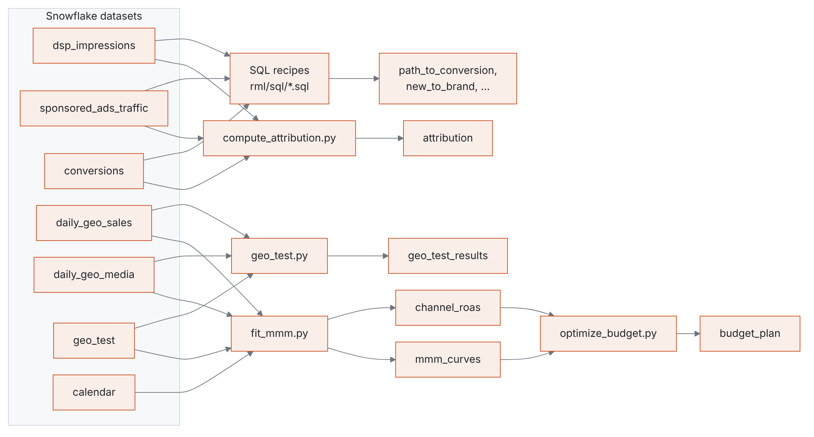

# Dataiku kit

Run the analysis as a Dataiku flow on a Snowflake connection. The logic lives in the tested
`rml` library; the recipes here only read and write Dataiku datasets.

## Flow

<picture>
  <source media="(prefers-color-scheme: dark)" srcset="../docs/img/dataiku_flow-dark.png">
  
</picture>

## Setup

1. **Data:** load the tables to Snowflake with `rml load` (see `snowflake/setup.sql`), then
   create a Snowflake connection in Dataiku and import the tables as datasets with the names
   above.
2. **Code environment:** a Python 3.11+ code env with
   `retail-media-lab @ git+https://github.com/faizanreza-cs/retail-media-lab`.
3. **SQL recipes:** one SQL query recipe per file in [`rml/sql/`](../rml/sql). The files are
   already in Snowflake SQL; paste them as they are, and output to a dataset with the same
   name as the file.
4. **Python recipes:** one per file in [`recipes/`](recipes), with the inputs and outputs named
   in each file's docstring.
5. **Scenario:** a weekly scenario that rebuilds `budget_plan` recursively, plus a check on
   `channel_roas` (for example, alert when an interval is wider than 1.0 ROAS).
